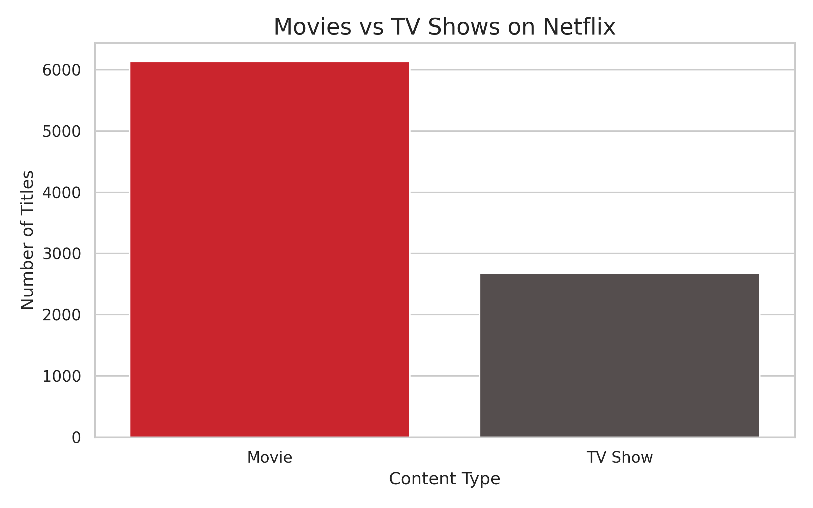
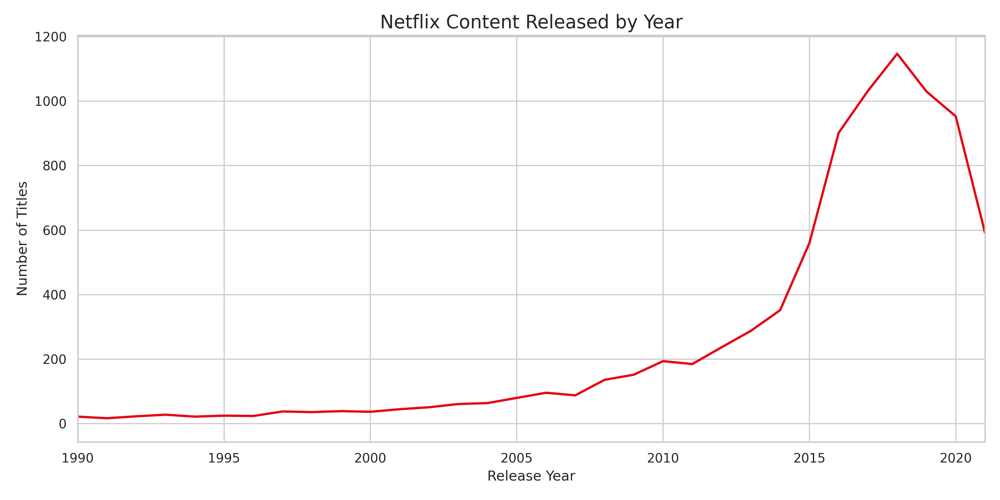
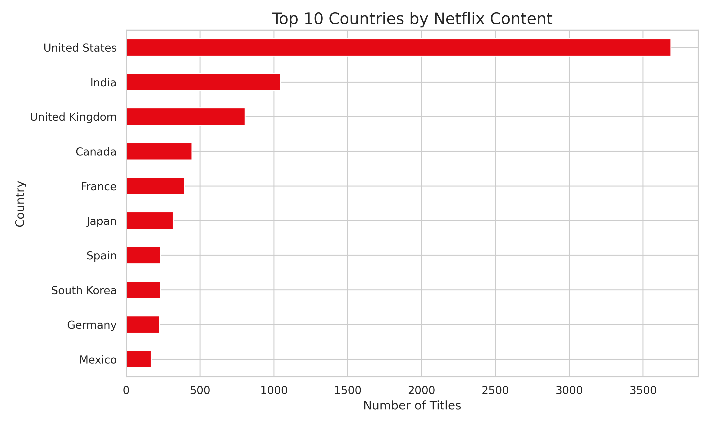
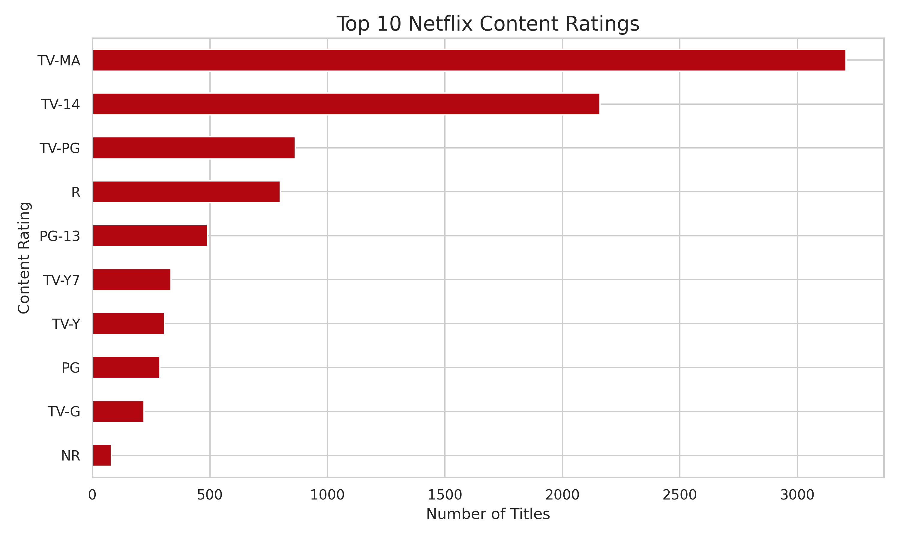

# Netflix Data Visualization & Analysis

## Project Overview

This project explores Netflix Movies and TV Shows data to understand content distribution, release trends, country contributions, and audience ratings.

Using Python and data visualization libraries, this project transforms raw Netflix data into meaningful insights through exploratory data analysis and interactive visualizations.

## Project Objectives

- Explore Netflix Movies and TV Shows data.
- Perform data cleaning and preprocessing.
- Analyze content distribution and release trends.
- Identify top content-producing countries and popular genres.
- Create static and interactive data visualizations.
- Present findings through a structured analysis report.

## Tools & Technologies

- **Python** – Data analysis and processing
- **Pandas** – Data cleaning and manipulation
- **Matplotlib** – Static data visualization
- **Seaborn** – Statistical data visualization
- **Plotly** – Interactive dashboard
- **Google Colab** – Development environment

## Dataset

The dataset contains information about Netflix movies and TV shows, including:

- Content type and title
- Director and cast
- Country of production
- Date added to Netflix
- Release year
- Content rating
- Duration
- Genre categories
- Content descriptions

**Source:** [Netflix Movies and TV Shows Dataset – Kaggle](https://www.kaggle.com/datasets/shivamb/netflix-shows)

## Data Analysis Process

1. Data Collection – Import the Netflix dataset.
2. Data Cleaning – Handle missing values, duplicates, and date formatting.
3. Exploratory Data Analysis – Examine content distribution and dataset characteristics.
4. Data Visualization – Create charts to identify patterns and trends.
5. Insight Generation – Summarize findings from the analysis.

## Visualizations

### 1. Movies vs TV Shows



### 2. Netflix Content Released by Year



### 3. Top 10 Countries



### 4. Content Ratings Distribution



## Interactive Dashboard

An interactive dashboard was developed using Plotly to explore Netflix content distribution, release trends, countries, and ratings.

**Dashboard file:** `visualizations/netflix_dashboard.html`

## Key Insights

See [Analysis Summary](insights/analysis_summary.md) for the findings generated from the dataset.

## Project Structure

```text
netflix-data-visualization/
│
├── README.md
├── data/
│   └── netflix_titles.csv
├── notebooks/
│   └── netflix_analysis.ipynb
├── visualizations/
│   ├── content_by_type.png
│   ├── content_by_year.png
│   ├── top_countries.png
│   ├── ratings_distribution.png
│   └── netflix_dashboard.html
└── insights/
    ├── analysis_summary.md
    └── conclusion.md

```

## How to Run

1. Clone this repository.
2. Open the notebook in Google Colab.
3. Upload the Netflix dataset if it is not included.
4. Run the notebook cells sequentially.
5. Explore the generated visualizations and analysis results.

## Author

**Data Analytics Portfolio Project**

This project was developed for learning and portfolio purposes.
